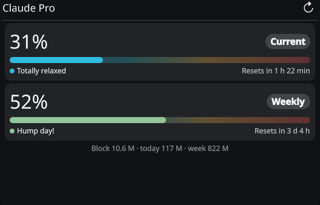
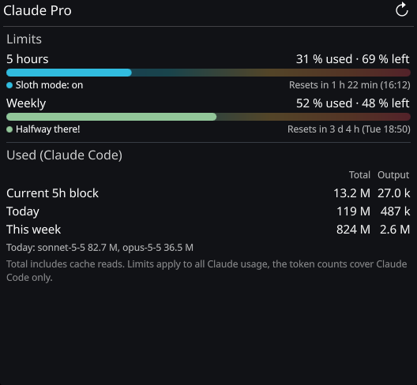
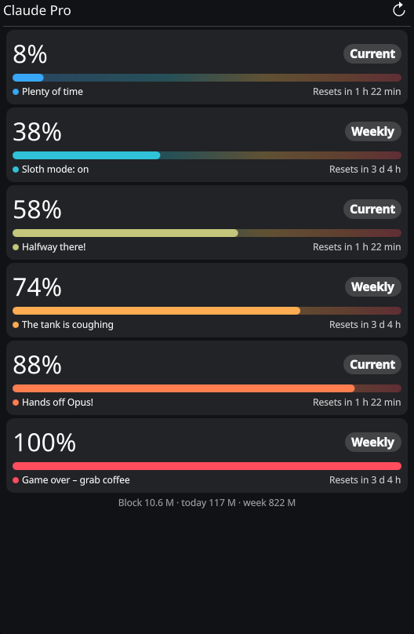
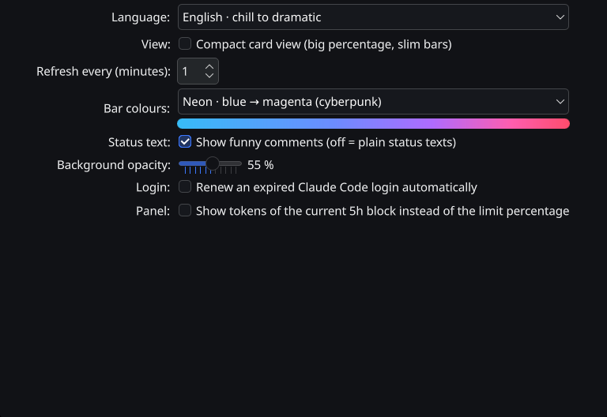
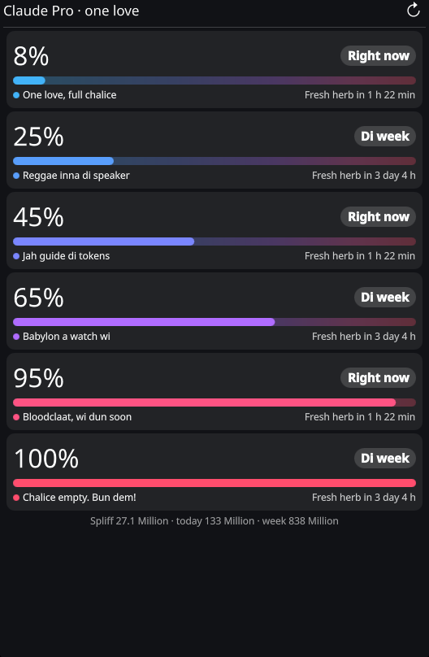
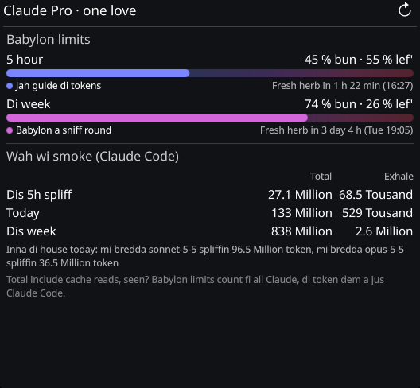
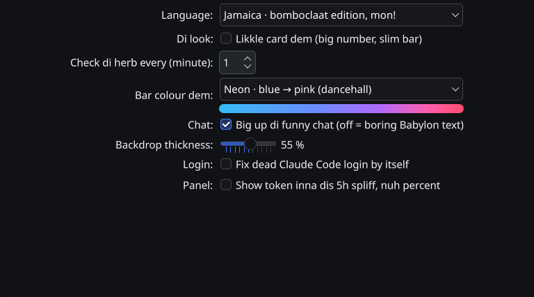
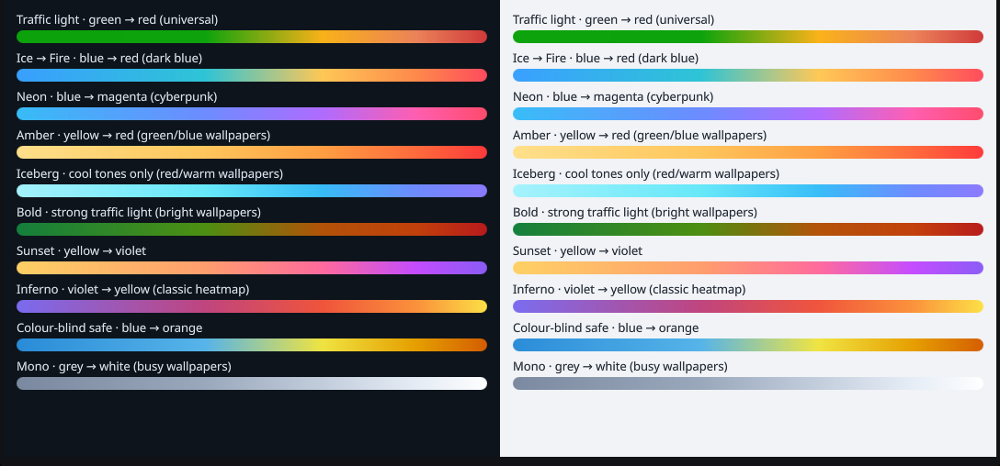

# Claude Usage – a KDE Plasma 6 widget

See how much of your **Claude plan limits** you have used – the 5-hour window and the weekly limit –
and how many **tokens** you have burned with Claude Code, right on your desktop or in a panel.
Colour-coded bars tell you at a glance whether you can cruise or should ease off, no matter how long the bar is.


> **Unofficial.** This project is not affiliated with, endorsed by or sponsored by Anthropic.
> "Claude" is a trademark of Anthropic. The widget reads data that Claude Code already stores on your machine and
> asks the same usage endpoint that Claude Code's `/usage` command uses (see [How it works](#how-it-works-and-what-it-touches)).

<p align="center">
  
  &nbsp;
  
</p>

<sub>Screenshots use made-up limit values.</sub>

## Features

- **Plan limits in percent** – 5-hour session and weekly limit with the time until they reset.
- **Token usage from your Claude Code logs** – current 5-hour block, today and this week, split by model.
- **Bars that tell the state** – the fill colour follows how much of the limit is used (green/blue → yellow → red),
  with the whole scale faintly visible behind the bar. A text label and a coloured dot always go with the colour,
  so it never relies on colour alone.
- **10 colour profiles** for different wallpapers, including a colour-blind-safe one.
- **Comments every 10 %** – "Totally relaxed" … "Hands off Opus!" … "Game over – grab coffee". Optional, can be switched off
  for plain status texts.
- **Languages:** English, German and a full **[Jamaican-patois edition](#jamaica--bomboclaat-edition)**. *Automatic* picks German for a German system, English otherwise.
- **Two views:** a detailed list or compact cards. Adjustable background opacity so it blends into your wallpaper.
- **Works on the desktop and in a panel** – percentages (or tokens) next to the icon, details on click and in the tooltip.

<p align="center">
  
  &nbsp;
  
</p>

## Jamaica · bomboclaat edition

*Because your limits deserve a soundtrack.* Pick **Jamaica** under *Language* and the whole widget switches to patois –
not just the comments, **every** label, tooltip, error message and the settings page:

- **"One love, full chalice"** at the start, **"Babylon a watch wi"** when it gets warm, **"Chalice empty. Bun dem!"** when the limit is gone.
- **Four variants per step** (five for the first one), re-rolled on every refresh, so the widget never says the same thing twice.
- Everything else gets the treatment, too: *Right now / Di week*, *Fresh herb in 1 h 22 min*, *Babylon limits*,
  *Wah wi smoke (Claude Code)*, *Big up di funny chat*, and even the colour profiles are renamed (*Negril sunset*, *Fiyah bun* …).

<p align="center">
  
  &nbsp;
  
</p>
<p align="center">
  
</p>

Made by [Recoil](https://github.com/Rec0iL) – big up! *Heads-up:* it contains strong language and drug references. It is opt-in and
*Automatic* never selects it. The screenshots show one of the variants, with made-up limit values.

## Requirements

- **KDE Plasma 6** (developed and tested on Plasma 6.7 / Wayland, Fedora).
- **Python 3** (standard library only, nothing to `pip install`).
- **Claude Code, signed in with a Claude account** – needed for the limit percentages. Without a login the widget still shows
  the token counts from your logs and a hint instead of the limits. API-key-only setups have no plan limits to show.
- `kpackagetool6` (part of Plasma 6) for installing.

## Install

```bash
git clone https://github.com/DonDavis-vibe/KDE-Plasma-Claude-usage-widget.git
cd KDE-Plasma-Claude-usage-widget
./install.sh
systemctl --user restart plasma-plasmashell    # Plasma loads QML only at startup; the panel/desktop flickers briefly
```

Then right-click the desktop or a panel → **Add Widgets…** → search for **Claude Usage** and drag it in.

`install.sh` is safe to re-run to update. It checks the package first, keeps a copy of the installed widget and **rolls back
automatically** if the update fails or is interrupted (`kpackagetool6 -u` alone would leave you with no widget at all).
Your widget settings are kept.

### Uninstall

```bash
./uninstall.sh
systemctl --user restart plasma-plasmashell
```

Remove the widget from your desktop/panel first. `uninstall.sh` also deletes the small cache in
`~/.cache/claude-usage-widget/`; it never touches your Claude Code files.

## Settings

Right-click the widget → **Configure Claude Usage…**

| Setting | What it does |
|---|---|
| Language | Automatic (default), English, Deutsch or Jamaica. Applies to the whole widget and this dialog. |
| View | Detailed (default) or compact cards. |
| Refresh every | How often to refresh, in minutes (default 1). Limits are cached for 2 minutes. |
| Bar colours | One of 10 profiles, with a preview of the whole scale. |
| Status text | Funny comments on or off (off = plain texts like "Plenty of room" … "Limit reached"). |
| Background opacity | 0–100 % (default 55 %), desktop only. In a panel the normal system background is used. |
| Login | Allow the widget to renew an expired Claude Code login automatically (see below). |
| Panel | Show the tokens of the current block instead of percentages in the panel. |

### Colour profiles

<p align="center"></p>

Traffic light, Ice → Fire (default), Neon, Amber, Iceberg, Bold, Sunset, Inferno, Colour-blind safe and Mono.
Pick the one that stays readable on your wallpaper. *Iceberg* and *Mono* have no red; there the dot and the text carry the warning.

## How it works and what it touches

The widget runs a small Python script ([`claude_usage.py`](package/contents/code/claude_usage.py)) that prints one JSON object.

**It reads**
- `~/.claude/projects/**/*.jsonl` – the Claude Code logs. Each line is parsed, but only token counters, timestamps, ids and model
  names are used; message content is never stored, printed or sent anywhere. These numbers cover **Claude Code on this machine only**.
- `~/.claude/.credentials.json` – the OAuth login of Claude Code, to ask for your plan limits.

**It contacts** (HTTPS only, no redirects, nothing else)
- `https://api.anthropic.com/api/oauth/usage` – the limit percentages. This is the endpoint behind Claude Code's `/usage`.
  **It is not publicly documented and may change or break at any time**; the widget then shows an error text instead of crashing.
- `https://platform.claude.com/v1/oauth/token` – only when your access token has expired *and* you allowed renewal.
  The renewal request uses Claude Code's public OAuth client id (it is not a secret; it ships inside Claude Code).

**It writes**
- `~/.cache/claude-usage-widget/` – a 2-minute cache and a lock file (directory `0700`, files `0600`).
- `~/.claude/.credentials.json` – **only** when it renews an expired token, exactly like Claude Code does, so the CLI keeps
  working with the rotated refresh token. The file is rewritten atomically with owner-only permissions, under a lock, after the
  new tokens were validated, and never over a newer login that Claude Code wrote in the meantime. You can switch this off in
  the settings; then an expired login simply shows "Login expired – run `claude` → /login in a terminal".

Hardening in short: all input (logs, server replies, cache) is treated as untrusted, validated and size-capped; the token is only
ever sent to the two fixed URLs above; the backend runs with `python3 -I`; text from outside is shown as plain text; tokens never
appear in output or error messages. Details and reporting: see [SECURITY.md](SECURITY.md).

## Troubleshooting

| Symptom | Fix |
|---|---|
| The widget looks old after an update | Restart Plasma: `systemctl --user restart plasma-plasmashell` (or `kquitapp6 plasmashell && kstart plasmashell`). |
| "Login expired" | Run `claude` in a terminal and sign in with `/login`. |
| "No Claude Code login found" | Claude Code is not installed or never signed in. The token counts still work. |
| Only tokens, no percentages | No Claude Code login, or an API-key-only setup. |
| `install.sh` says "restored" and fails | The update failed and your previous widget is still in place. Read the error above that message. |
| Widget or settings page empty | Check `journalctl --user -b \| grep -i claudeusage`, then re-run `./install.sh` and restart Plasma. |

Run the backend on its own (prints JSON; `--force` ignores the cache, `--no-refresh` never renews the login):

```bash
python3 -I package/contents/code/claude_usage.py --force | python3 -m json.tool
```

## Development

```
package/                      the Plasma widget (what kpackagetool6 installs)
  metadata.json
  contents/code/claude_usage.py   backend: logs, limits, login renewal, caching
  contents/ui/main.qml            widget UI (panel icon, compact and full view)
  contents/ui/configGeneral.qml   settings page
  contents/ui/StatusBar.qml       the bar (faint scale + solid state colour)
  contents/ui/ColorSchemes.qml    the 10 colour profiles
  contents/ui/CommentSets.qml     language packs: comments + all interface texts
  contents/config/                settings schema
tests/                        backend, translation and install tests
install.sh / uninstall.sh
docs/screenshots/
```

Run the tests (no Plasma needed for the first two):

```bash
python3 -I tests/test_backend.py        # backend, incl. login renewal against a local mock server
python3 -I tests/test_translations.py   # every language pack is complete and fits on the cards
bash tests/test_install.sh              # install/update/rollback, needs kpackagetool6; uses a throw-away data dir
```

The tests never touch your real `~/.claude` files or the real endpoints.

**Add a language:** append an entry to `sets` in [`CommentSets.qml`](package/contents/ui/CommentSets.qml) with `lang`, `locale`,
`comments` (11 steps: 0–9 %, …, 90–99 %, 100 %; each step a string or a list of variants, max. 24 characters), `schemes`
(names of the 10 colour profiles) and `ui` (a replacement for every German source text), then raise `<max>` of `commentSet` in
[`main.xml`](package/contents/config/main.xml). `tests/test_translations.py` tells you what is missing.

**Add a colour profile:** append five colours to `schemes` in [`ColorSchemes.qml`](package/contents/ui/ColorSchemes.qml), add its name
to each language pack's `schemes`, and raise `<max>` of `colorScheme`.

The interface source strings are German (the project started that way); the English pack is a complete translation.

## Credits

- The **Jamaica · bomboclaat edition** language pack (patois comments and interface texts) was contributed by [Recoil](https://github.com/Rec0iL).
  It contains strong language and drug references; it is opt-in and the default language is never this one.
- The *Traffic light* profile uses a standard status palette (green, amber, orange, red); the *Colour-blind safe* profile is based on the
  Okabe–Ito colours.

## License

[MIT](LICENSE)
